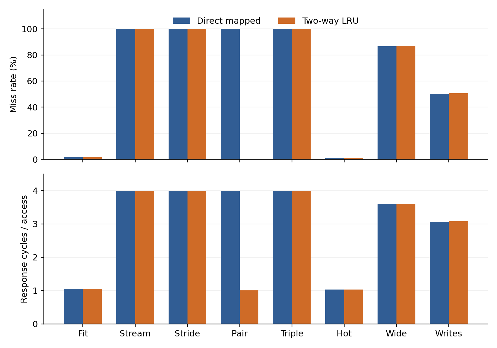

# Two-Way Set-Associative Cache with LRU

Verilog cache project with 16 sets, two ways, 4-byte lines, and 32-bit byte
addresses. The cache holds 128 bytes and uses exact LRU, write-back, and
write-allocate.

## Run and reproduce

Install Icarus Verilog, Make, and Python 3, then run:

```sh
make test benchmark
```

The directed suite passes 15 checks. Phase II checks 32,768 RTL transactions
across eight workloads on the two-way cache and an equal-capacity direct-mapped
baseline. Both use write-back, write-allocate, and the same controller timing.
Generated traces and executables are in `build/benchmarks/`.

[Final IEEE report](docs/phase2-report.pdf) ·
[Methodology](docs/phase2-methodology.md) ·
[Measured CSV](results/benchmarks.csv) ·
[Interview preparation](docs/interview-guide.md)



The alternating conflict pair has 2 misses with two-way LRU and 2,048 with
direct mapping. Wide random and mixed-write traces show similar performance,
with direct mapping slightly ahead in this run. All numerical claims describe
the fixed-delay simulation. [Run metadata](results/metadata.json) records the
seed and simulator. [Simulation log](results/simulation.log) contains each run.
Optional chart regeneration requires matplotlib:

```sh
python3 scripts/plot_results.py
```

For the Phase I waveforms, open `build/cache.vcd` after `make test` or view
the [miss and hit](sim/cold-miss-hit.png) and
[dirty eviction](sim/lru-dirty-eviction.png) captures.

## Interface

- The CPU request transfers on a rising edge with `req_valid && req_ready`.
  Assert `req_write` for a store. One request may be in flight.
- `resp_valid` marks a one-cycle response. `resp_hit` reports the original
  lookup result. `resp_error` flags unaligned requests. `resp_rdata` carries
  the read word, echoes a written word, or returns zero on an error.
- A rising edge with `mem_valid && mem_ready` completes a memory command.
  The test model uses 4 KiB and responds on the third eligible clock edge.
  It supports aligned word addresses from `0x00000000` through `0x00000FFC`;
  an out-of-range memory command terminates the simulation. The cache itself
  decodes all 32 address bits.
- Reset is synchronous and invalidates the cache without flushing dirty
  lines. The behavioral backing memory preserves its contents.

## Files

- `src/` contains cache RTL and the direct-mapped baseline.
- `tb/` contains the behavioral memory and testbench.
- `docs/` contains the final report, review assignments, interview guide,
  [Phase I report](docs/phase1-report.pdf), and [diagrams](docs/architecture.md).
- `scripts/` contains the trace generator, reference model, benchmark runner, and plotter.
- `results/` contains measured data, logs, metadata, and the comparison figure.
- `sim/` contains waveform captures and the VCD.

## Team assignments

| Member | Assigned scope |
| --- | --- |
| Aaditya Yadav | Behavioral memory, testbench, and waveform evidence |
| Gauri Mishra | Controller FSM, write policy, and top-level integration |
| Bhumi Rastogi | Tag and data arrays and address decoding |
| Ansh Sharma | LRU state and victim selection |
| Anugra | IEEE report, diagrams, and README |

For Phase II review responsibilities and a place to record actual member work,
see the [team review record](docs/phase2-team-review.md). This delivery uses
coding-assistant support and commits through Aaditya's account. Members should
record their own reviews and follow-up changes in their own commits.

## Phase I video

[Watch the Phase I video on Google Drive](https://drive.google.com/file/d/1e6Uwf2_9PiLDKSvvyJBBiOG0WJrM6FKX/view?usp=sharing)
