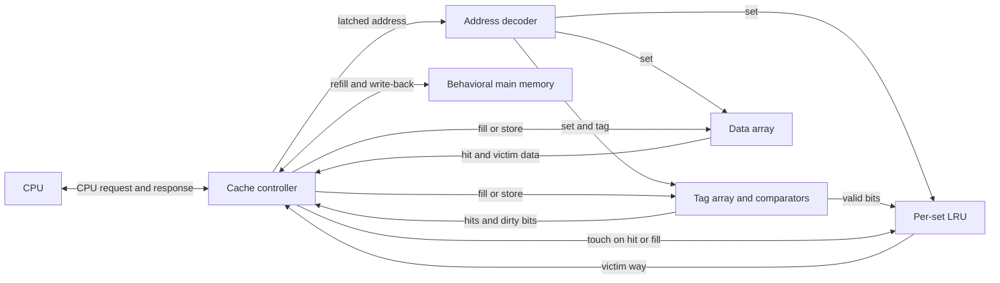
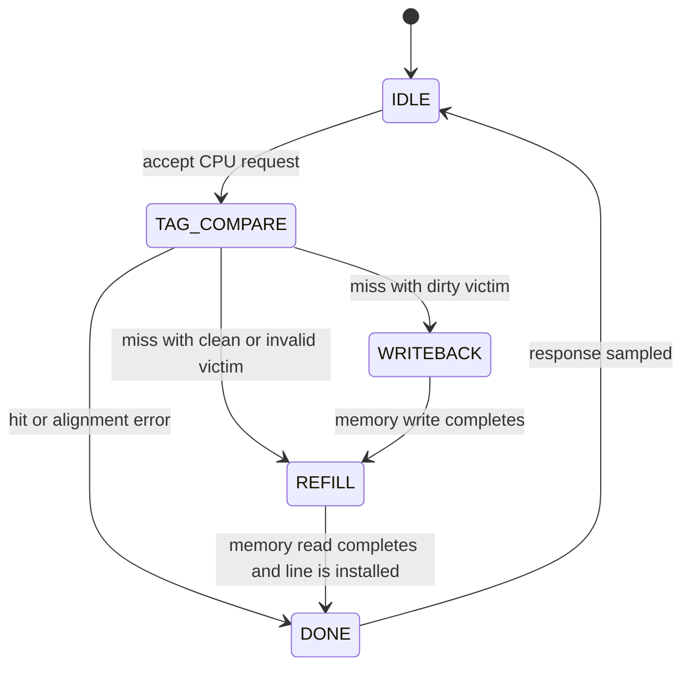

# Architecture

The decoder splits the byte address into tag [31:6], set [5:2], and offset [1:0].
Victim priority is invalid way 0, invalid way 1, then the set's LRU bit.
After accessing way w, the bit records 1 - w.
